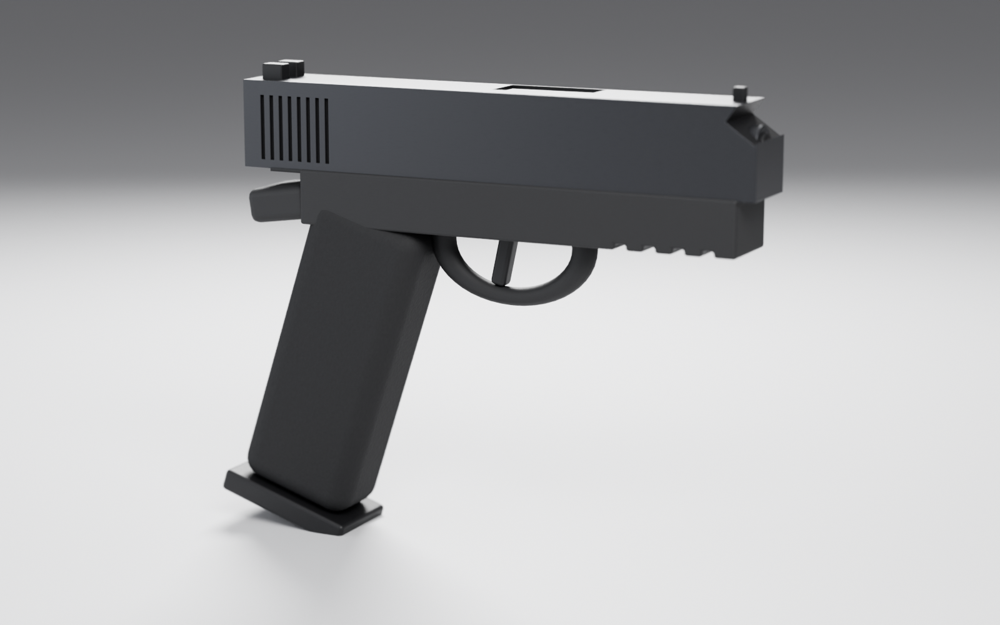

# Procedural Pistol-Style Prop (Blender / Python)

A black polymer pistol-style hard-surface **visual prop**, built entirely from Python (`bpy`).
It uses no reference images and no downloaded models. It covers the exterior only; there are no functional mechanisms.



## Files
| File | Purpose |
|---|---|
| `generate_model.py` | Resets the scene, builds the geometry and materials, saves `project.blend` |
| `setup_scene.py` | Adds the studio floor and world, 4 area lights (key/fill/rim/top), the camera, and Cycles settings |
| `render_preview.py` | Checks that the required objects exist, then renders `renders/preview.png` |
| `export_asset.py` | Exports the MODEL + MATERIALS_AND_DETAILS collections to `exports/model.glb` and `exports/model.fbx`, then checks the files |
| `run_all.py` | Runs all four steps in one process (for the standalone `bpy` module) |

## Running
With Blender installed (run the steps in this order):
```bash
blender -b -P generate_model.py
blender -b -P setup_scene.py
blender -b -P render_preview.py
blender -b -P export_asset.py
```
Without a Blender install, use the `bpy` wheel (requires Python 3.13):
```bash
python3.13 -m venv venv && ./venv/bin/pip install bpy
./venv/bin/python run_all.py
```
All paths are absolute and derived from the script's directory. `generate_model.py` starts from
factory settings, and `setup_scene.py` clears its own collections before rebuilding them, so running the
scripts again does not duplicate objects.

## Verified environment
- The pipeline ran with the **`bpy` 5.2.2 LTS** module on Python 3.13 (Linux, CPU Cycles).
- Render: Cycles CPU, 96 samples, denoised, 1600×1000, AgX view transform, light depth of field (f/5.6). Takes about 2 minutes on CPU.
- After a rerun the scene holds 23 objects: 6 in MODEL, 11 in MATERIALS_AND_DETAILS, 4 lights, 1 camera, 1 floor.
- Both export operators returned `FINISHED`. GLB is about 240 KB and FBX about 221 KB.

## Scene structure
Collections: `MODEL`, `MATERIALS_AND_DETAILS`, `LIGHTING`, `CAMERAS`, `ENVIRONMENT`.
Every part is parented to the `PISTOL_ROOT` empty. Bevel modifiers stay live in the `.blend` so they remain
editable, and they are applied on export. The cosmetic grooves on the slide and frame are boolean cuts,
applied at generation time, as are the 45° chamfers on the top edges of the slide and the angled cut at the muzzle.
Every material gets subtle procedural roughness variation (Noise → Map Range → Roughness).

Materials (Principled BSDF). Their values are in the `MATERIALS` dict at the top of `generate_model.py`:
- `Matte_Black_Polymer` – frame, beavertail, trigger guard
- `Grip_Texture_Polymer` – grip, with a fine noise-driven bump for stippling
- `Dark_Graphite_Surface` – slide, barrel hood, muzzle (slightly metallic, restrained)
- `Black_Accent_Material` – sights, trigger, levers, magazine base, groove walls

## Export settings
- **GLB**: `export_scene.gltf`, GLB format, selection only, modifiers applied, +Y up.
- **FBX**: `export_scene.fbx`, selection only, mesh modifiers applied, FBX_SCALE_ALL, -Z forward / Y up.

## Known limitations / not verified
- The procedural stippling (bump from a Noise Texture node) exists only in Blender. GLB and FBX
  get the base color, roughness and metallic values but **not** the grip texture, because no textures are baked.
- The exported files were checked for operator result and non-zero size only. They were not
  re-imported or inspected in a game engine.
- The proportions are stylized and approximate, and the geometry is deliberately simple (box and torus based).
- The angled cut at the front of the slide exposes part of the barrel cylinder; it could be cleaner.
- The GLB exporter logs that the Draco/MeshOptimizer libraries are missing from the `bpy` wheel.
  They are only needed for optional compression, which is not used.
