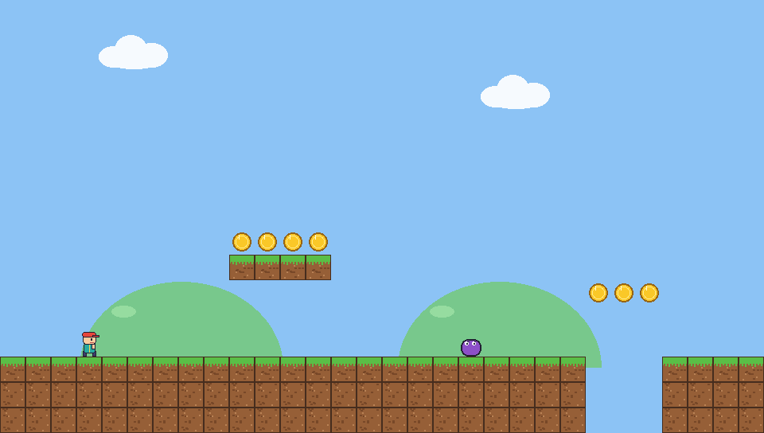

# Plataforma Teste (GameMaker)

Jogo de plataforma 2D completo feito para o GameMaker: sprites, animações, sons, 2 fases, inimigos, moedas, espinhos, bandeira de fim de fase, HUD, vidas, pontuação, tela de título, game over e vitória.

## Como abrir
- **`PlatformerTeste.yyz`**: no GameMaker, *File > Import Project* (ou dê dois cliques no arquivo).
- **`PlatformerTeste.zip`** / pasta `PlatformerTeste/`: extraia e abra o `PlatformerTeste.yyp`.

O projeto está no formato GameMaker Studio 2.3; o GameMaker atual converte automaticamente ao abrir (aceite o upgrade).

## Controles
| Tecla | Ação |
|---|---|
| Setas / A, D | Mover |
| Espaço / W / Cima | Pular (segure para pular mais alto) |
| Enter | Começar / reiniciar no menu |
| R | Reiniciar a fase |
| Esc | Sair |

## Estrutura
- `obj_game` – monta a fase a partir do mapa de texto, câmera com parallax, HUD e telas.
- `obj_player` – física com aceleração, coyote time, buffer de pulo e pulo variável.
- `obj_enemy` – patrulha e vira em paredes/beiradas; morre ao ser pisado.
- `obj_block`, `obj_coin`, `obj_spike`, `obj_flag`.
- `scr_levels` – as fases em texto (`#` bloco, `P` jogador, `C` moeda, `E` inimigo, `^` espinho, `F` bandeira). Para criar fases novas, basta editar/adicionar strings.
- Sons (`snd_jump`, `snd_coin`, `snd_stomp`, `snd_death`, `snd_win`) e sprites são originais, gerados para este projeto.
